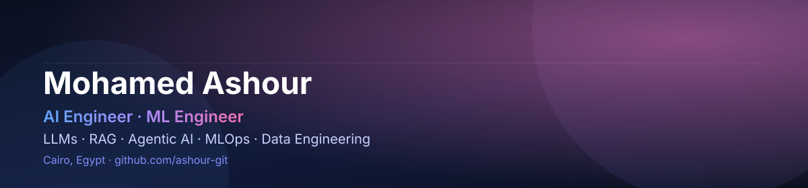

  

  
  
  
  

---

## About

**AI Engineer** building production **AI governance and compliance systems** at **SustainGRC**, a UK-based AI-native GRC & ESG SaaS platform. My work sits at the intersection of AI engineering and regulatory compliance — designing AI modules that operate under real constraints:

- Multi-tenant architecture
- Audit-grade data integrity
- EU AI Act alignment

From deterministic risk classification and RAG assistants to MLOps pipelines on Azure, I build AI that enterprises can actually depend on.

---

## Currently Working On

- Deterministic AI-risk classification engines with hash-chained audit trails
- AI-assisted compliance drafting (Anthropic Claude on Azure AI Foundry)
- RAG assistants over enterprise data (pgvector + endpoint models)
- Shadow AI discovery — matching network logs against vendor signature libraries
- MLOps and data pipelines on Azure, from ingestion to model serving

---

## Tech Stack

- **AI / LLMs** — RAG, agentic AI, prompt engineering, Hugging Face Transformers, LangChain, pgvector, ChromaDB, embeddings, NLP
- **Machine learning** — LightGBM, Scikit-Learn, PyTorch, Optuna, MLflow, time-series forecasting, fine-tuning
- **Computer vision** — OpenCV, YOLOv5, MediaPipe, ResNet-50, CNNs
- **Backend & data** — FastAPI, Next.js, Node.js, PostgreSQL, Redis, SQLAlchemy, Drizzle ORM, Pandas, NumPy
- **Languages** — Python, TypeScript, JavaScript, SQL
- **Cloud & MLOps** — Azure AI Foundry (Anthropic Claude), Azure OpenAI, Docker, Docker Compose, GitHub Actions

---

## Experience

**AI Engineer — SustainGRC** · Remote · 2026 – Present

- Engineered a deterministic EU AI Act classification engine with five risk gates and a hash-chained audit trail
- Delivered AI-assisted compliance drafting powered by Anthropic Claude on Azure AI Foundry
- Implemented AI discovery matching network logs against a vendor signature library
- Built a climate-risk data pipeline with country-specific physical-risk multipliers
- Shaped the AI-governance product roadmap through product and competitor analysis

**Data Engineer Intern — SustainGRC** · Remote, 2025 – 2026

- Designed and shipped a Text-to-SQL feature translating natural language into executable SQL via GPT-4o
- Automated backup and disaster-recovery pipelines with integrity-validation checksums
- Applied FAIR data principles and automation across ESG data governance

**Machine Learning Intern — CodeAlpha** · Remote, 2024

- Fine-tuned a ResNet-50 image classification model
- Built a music recommendation prototype with collaborative filtering

---

## Projects

### RestAI — AI-Powered Restaurant Management SaaS
`Python` · `FastAPI` · `Next.js` · `LightGBM` · `Groq Llama 3.3 70B` · `RAG` · `pgvector` · `Docker`

- LightGBM demand forecasting tuned with Optuna over lag and rolling-window features
- RAG assistant over menu and operational data via pgvector and sentence-transformers
- Hybrid recommender combining co-occurrence and content-based signals; 162 automated tests

### Storefy — AI-First Multi-Tenant E-Commerce Platform
`Next.js 15` · `TypeScript` · `PostgreSQL` · `Drizzle ORM` · `Groq Llama 3.3 70B` · `Better Auth` · `Inngest`

- Multi-tenant platform with wildcard-subdomain routing and database-level isolation per tenant
- Natural-language AI POS, natural-language analytics, and AI business advisor
- Generative storefront onboarding from a text description

### Text-to-SQL Generator
`Python` · `Azure OpenAI (GPT-4o)` · `Defense-in-depth validation` · `GitHub Actions`

- Production-hardened natural language-to-SQL converter with multi-layer security validation — 100% security test coverage (18/18 tests)

### Semantic Search Utilities
`Python` — semantic-search recommendation over 7,000+ books via vector embeddings, ~67 ms average query

---

## Education & Certifications

**B.Sc. Computer Science** — Zagazig University · 2023

- **Supervised Machine Learning** — DeepLearning.AI
- **AWS Machine Learning Foundations** — Amazon
- **Claude Code in Action** — Anthropic
- **IEEE Delta Academy** — AI Track (Member)
- **Microsoft Machine Learning Track** — Digital Egypt Pioneers Initiative (DEPI)

---

## GitHub Stats

  
  
    
  

---

  Building production AI systems that are practical, governed, and cost-effective.  
  <a href="https://www.linkedin.com/in/mohamedashour-ai">LinkedIn</a> ·
  <a href="resume_pdf/MOHAMED_ASHOUR_RESUME.pdf">Resume</a> ·
  <a href="mailto:muhamed.3ashour@gmail.com">Email</a>

