<!--
  Owner: Mohamed Ashour. Last reviewed: 2026-11-16.
  Review this page when: the role or employer changes, a pinned project ships or is archived,
  the resume is updated, or a job search starts. Every claim below should match the resume.
  Art is procedural: edit and re-run `python assets/render_space.py`.
-->

<a href="https://mohamed-ashour.vercel.app"></a>

AI Engineer working across LLMs, NLP and computer vision. I build RAG pipelines, LangGraph agents and Text-to-SQL systems with evals and guardrails, and ship them as production services at **SustainGRC**.

**[Portfolio](https://mohamed-ashour.vercel.app)** &nbsp;&nbsp;/&nbsp;&nbsp; **[LinkedIn](https://www.linkedin.com/in/mohamedashour-ai)** &nbsp;&nbsp;/&nbsp;&nbsp; **[Resume](resume_pdf/Mohamed_Ashour_AI_Engineer.pdf)** &nbsp;&nbsp;/&nbsp;&nbsp; **[Email](mailto:muhamed.3ashour@gmail.com)**

<br/>

<table>
<tr>
<td width="56%" valign="top">

### At SustainGRC

AI Engineer since September 2025, after joining as a data engineering intern in July.

**LLM service.** Claude Haiku 4.5 on Azure AI Foundry generates structured long-form reports in under 30 seconds.

**Text-to-SQL.** GPT-4o turns analyst questions into executable SQL behind two independent validation layers. Passed 18/18 security tests before release.

**Deterministic classifier.** A rule engine that sorts AI systems into the five EU AI Act risk tiers, with a hash-chained audit trail and approval rules enforced in PostgreSQL.

**Log-matching pipeline.** Matches network logs against a database-backed signature library to flag unregistered AI tools.

`Python` `LangGraph` `DSPy` `RAG` `pgvector` `FastAPI` `PostgreSQL` `Azure` `Docker`

</td>
<td width="44%" valign="middle" align="center">

</td>
</tr>
</table>

### Selected work

**[RestAI](https://github.com/ashour-git/Restaurant_AI)** &nbsp; Restaurant management SaaS with a separate ML service<br/>
LightGBM demand forecasting tuned with Optuna, and a pgvector RAG assistant on Llama 3.3 70B grounded in live menu and order data. 162 automated tests.<br/>
<sub>FastAPI, Next.js, LightGBM, pgvector, PostgreSQL, Docker</sub>

**[Retail Analytics Copilot](https://github.com/ashour-git/retail-analytics-copilot)** &nbsp; Hybrid RAG and SQL agent<br/>
An 8-node LangGraph workflow routes each question between BM25 retrieval and SQL. DSPy tuning took valid, executable SQL from 50% to 100% on the eval set.<br/>
<sub>LangGraph, DSPy, Ollama, BM25, SQLite</sub>

**[Storefy](https://github.com/ashour-git/storefy)** &nbsp; Multi-tenant commerce platform for the Egyptian market<br/>
Database-level tenant isolation, wildcard-subdomain storefronts, Paymob split payouts, and onboarding that generates a store theme and starter catalog from a text description.<br/>
<sub>Next.js 15, TypeScript, Neon Postgres, Drizzle, Llama 3.3 70B, Inngest</sub>

### Path

```text
2025-09  now      AI Engineer               SustainGRC
2025-07  2025-09  Data Engineer Intern      SustainGRC    Text-to-SQL, backup and disaster recovery
2024-05  2024-12  Machine Learning Intern   CodeAlpha     ResNet-50 fine-tuning, music recommender
2023              B.Sc. Computer Science    Zagazig University
```

### Contact

Email is the fastest route: muhamed.3ashour@gmail.com. The [resume](resume_pdf/Mohamed_Ashour_AI_Engineer.pdf) has the full history.


